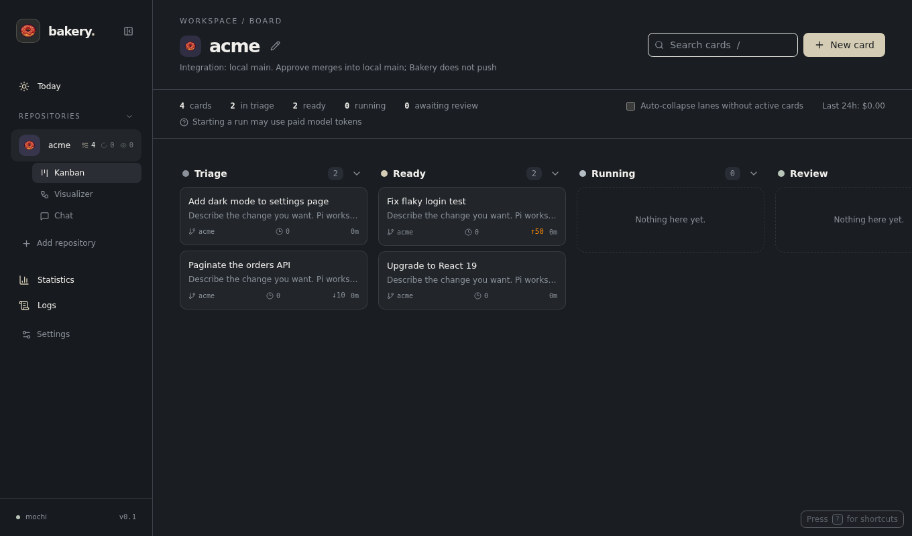
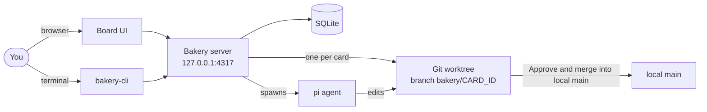

# Bakery

A local kanban board that hands coding tasks to [Pi](https://pi.dev) agents, one Git worktree per card. Nothing reaches your `main` branch until you approve it.



- [Why Bakery](#why-bakery)
- [Problems it solves](#problems-it-solves)
- [Bakery and Hermes](#bakery-and-hermes)
- [How to use](#how-to-use)
- [What's next](#whats-next)
- [Contributing](#contributing)
- [Documentation](#documentation)

## Why Bakery

You write down tasks. Agents work on them in the background, each in its own checkout, and you review the diffs when you're ready. You stay the one who decides what lands.

- **Safe by default.** Every card gets its own worktree and branch (`bakery/CARD_ID`). Your checkout is never touched while an agent works.
- **You approve.** A finished run only reaches **Review**. Bakery doesn't push, deploy, or write to an issue tracker unless you turn that on.
- **Local.** One server on `127.0.0.1`, one SQLite file, no account.
- **Parallel.** Several cards can run at once, and cards can wait on other cards.



## Problems it solves

- **Agents step on your work.** Running an agent in your checkout mixes its edits with yours. Bakery gives each task a separate worktree.
- **Parallel tasks collide.** Cards run side by side without sharing files, and dependencies make a card wait until the cards it needs are Done.
- **Changes land unreviewed.** Review shows the diff, lets you comment on lines and send the card back, and only your approval merges it.
- **Work gets lost between sessions.** Cards, attempts, transcripts, costs and review history stay on the board, and a retry continues the same Pi session.
- **Spend is invisible.** Each attempt shows its tokens and cost, the board shows the last 24 hours, and an optional daily budget stops automatic pickup.
- **Babysitting.** Opt-in automatic pickup starts Ready cards for you, and opt-in unattended review verifies, reviews and merges (or opens a PR) without you.

## Bakery and Hermes

[Hermes](https://github.com/NousResearch/hermes-agent) is a general-purpose agent you talk to. Bakery is narrower: a task board for coding work, built around Git and review.

| | Bakery | Hermes |
| --- | --- | --- |
| Shape | Kanban board and CLI over a local server | An agent you converse with |
| Unit of work | A card with its own worktree, branch and attempts | A conversation or session |
| Scope | Coding tasks in your Git repositories | General tasks |
| Agent | Pi | Hermes's own agent |
| Results | A diff you review, then merge or open a PR | Whatever the agent produces |
| Merging | Only on your approval, or unattended review you enable | Not a built-in concept |

Hermes is also a fine way to work on code. Pick Bakery when you want a queue of tasks, isolation per task and an approval step before anything lands. The Hermes column is a summary of its public README; check it for what Hermes does today.

## How to use

You need Node 24, Git, and `pi` on your `PATH` with a configured provider.

```sh
git clone <this repository> && cd bakery
npm install
npm run dev
```

Open http://127.0.0.1:5173, then:

1. **Add a repository** by entering its Git root (an absolute or `~/` path). It needs at least one commit.
2. **Create a card.** New cards start in **Triage**.
3. **Move it to Ready and start it.** Starting a run uses paid model tokens.
4. **Review.** When Pi finishes, read the diff, then **Approve and merge into local main** (or **Approve and open PR** on a GitHub pull request board), or **Request changes**.

Uncommitted files in your checkout don't appear in card worktrees.

From a terminal, `npm run bakery -- add fix the flaky login test` captures a card in the repository you're in, and `npm run bakery -- doctor` checks your setup. For production, run `npm run build && BAKERY_SERVE_UI=1 npm start` and open http://127.0.0.1:4317.

Everything else (the card lifecycle, dependencies, the visualizer, GitHub pull request mode, automation, the full CLI, hosting on another machine) is in the [reference](docs/reference.md).

## What's next

- Read-only Linear import into local cards, keyed by issue ID. Bakery won't write to Linear.
- Better process identity checks for interrupted runs, beyond PID liveness.
- External CI before approval and automatic card creation.

## Contributing

Issues and pull requests are welcome. Before you open one:

```sh
npm test               # fake offline pi and temporary Git repositories; no model calls
npm run build          # runs format:check, tsc, and vite build
npm run format         # fixes formatting in the covered frontend files
```

- Keep a change focused on one thing, and add or update a test for behavior you change.
- The formatter check covers the board, card details, review, attempts, usage, API, and model modules. It doesn't cover server or test files yet.
- Tests never touch repositories you've added to Bakery.

## Documentation

- [Reference](docs/reference.md): every feature, setting, CLI command and environment variable.
- **Safety:** Pi is told not to commit, push, or publish, but **that isn't a sandbox**. Only run agents on repositories you trust. The server has no authentication and listens on `127.0.0.1` only; see [Safety](docs/reference.md#safety) and [Hosting on another machine](docs/reference.md#hosting-on-another-machine).
