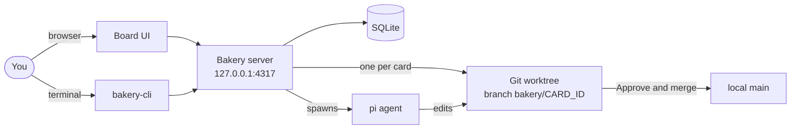
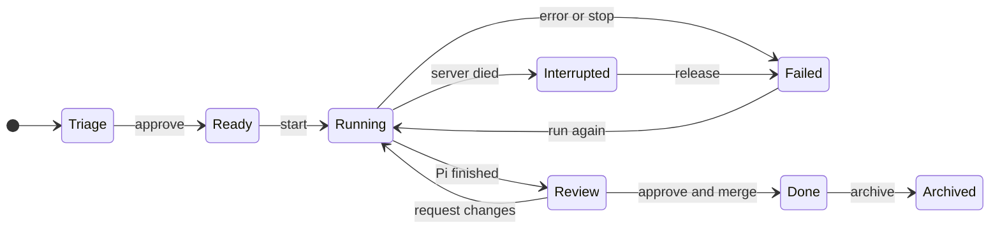
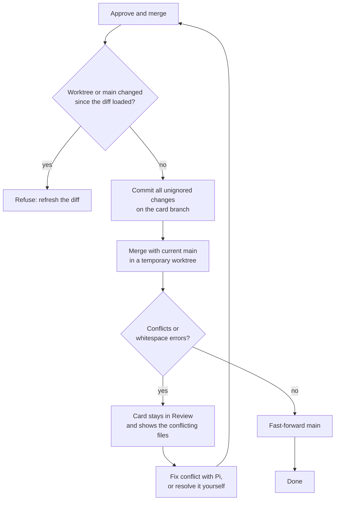
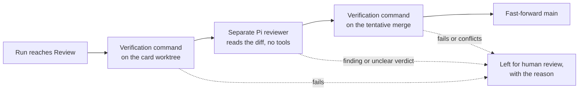
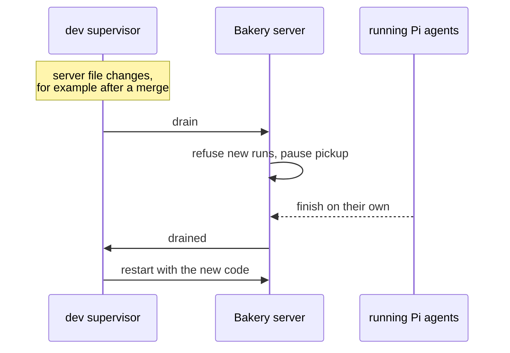

# Bakery

Bakery is a local kanban board that hands coding tasks to Pi agents, one Git worktree per card. Nothing reaches your `main` branch until you approve it.

Bakery never pushes, opens PRs, deploys, or writes to an issue tracker.



## Contents

- [Quick start](#quick-start)
- [Card lifecycle](#card-lifecycle)
- [Reviewing and merging](#reviewing-and-merging)
- [Watching a run](#watching-a-run)
- [Automation (opt-in)](#automation-opt-in)
- [CLI](#cli)
- [Boards and lanes](#boards-and-lanes)
- [Server, data, and restarts](#server-data-and-restarts)
- [Safety](#safety)
- [Development](#development)

## Quick start

You need Node 24, Git, and `pi` on your `PATH` with a configured provider.

```sh
npm install
npm run dev
```

Open http://127.0.0.1:5173.

To run a single production server instead, run `npm run build && npm start` and open http://127.0.0.1:4317.

Then:

1. Add a repository by entering its Git root, either an absolute path or a `~/` path. The repository needs at least one commit, because worktrees start from `HEAD`.
2. Create a card. New cards start in **Triage**.
3. Move the card to **Ready**, then start it. Starting a run uses paid model tokens.
4. When Pi finishes, the card moves to **Review**. Read the diff, then **Approve and merge** or **Request changes**.

Uncommitted or untracked files in your checkout don't appear in card worktrees.

### Worktrunk hooks

If [Worktrunk](https://worktrunk.dev) is installed, Bakery runs your repository's creation hooks in each new card worktree before Pi starts. Use them to install dependencies or copy `.env` and other ignored files (`wt step copy-ignored`). Hooks live in `.config/wt.toml` in the repository, or in `~/.config/worktrunk/config.toml`.

- `pre-start` hooks run first, and Pi waits for them. If one fails, the attempt fails with the hook output in its transcript. Bakery removes the new worktree and branch so the next attempt runs the hooks again.
- `post-start` hooks start in the background, as they do under `wt switch`.
- Hooks run only when Bakery creates the worktree. Retries and conflict repairs reuse it without running them.
- Bakery passes `--yes`, so project hooks run without Worktrunk's approval prompt. Pi runs commands in the same worktree anyway.
- Bakery still picks the worktree path and handles review and merge itself. It doesn't call `wt switch` or `wt merge`.

## Card lifecycle



- **A finished run only reaches Review.** Only your approval, or unattended review, moves a card to Done.
- **Stop** and the 30-minute timeout both end a run as Failed.
- **Mark done** closes a Triage or Ready card that never ran. An unrun Ready card can also go back to Triage.
- **Retries reuse the card's worktree and Pi session**, so Pi continues where it left off.
- **Interrupted** cards can't be retried until you check the worktree and release the card. Bakery first confirms that the recorded PID is no longer running. A PID reused by an unrelated process also blocks release.
- **Reopen** returns a Done card to Review when its work was left unmerged in the worktree. If the card was already merged, it returns to Ready.
- **Restore to Done** brings an archived card back. **Archive** only changes the lane. Runs, worktrees, branches, and history stay.
- Only Done cards can be archived. To archive several at once, use **Select** in the Done lane.

## Reviewing and merging

The Review diff shows what the card changed since its branch split from `main`, including unignored files the agent didn't commit. Newer work on `main` doesn't show up as deletions.

To request revisions:

1. Select a line, write a comment, and add it as a draft.
2. Click **Request changes** to submit the drafts. This does not start Pi.
3. Click **Run again** when you're ready. Pi gets your comments in its prompt.

Drafts must be submitted or removed before you can approve. Comments stay as history on later diffs, where their line positions may have moved.

When you approve:



- Manual approval doesn't run tests or CI, and doesn't push.
- Your own uncommitted edits on `main` stay in place. Git refuses a merge that would overwrite them.
- **Fix conflict with Pi** starts a new attempt in the card's worktree. Pi may merge `main` into the card branch and commit there, but must not touch `main`.
- After a conflict fix, you review the result again before it merges.
- If approval fails in another way, **Withdraw approval** unlocks the card for revision. It never removes commits or worktrees. If `main` has already moved, Bakery refuses and asks you to inspect.
- Diffs over 200 files or 2 MB can't be approved in Bakery. Binary files need checking in the worktree.
- If you merge a card's branch into `main` yourself, Bakery notices on its next tick and marks the card Done. This only applies when the worktree is clean and the merge actually changed `main`.

## Watching a run

Each attempt in a card's **Attempts** list shows:

- The agent that ran it as `provider/model`, for example `anthropic/claude-…` or `openai-codex/gpt-…`. The board card shows the latest run and review agents.
- A transcript: assistant text, plus one line per turn with tool counts, failures, and changed files. Tool arguments and results aren't stored. Pi's own session has the full conversation.
- Its cost, as reported by Pi on each assistant message. Hover it for input, output, and cache token counts. Attempts from before Bakery tracked usage show `—`, not `$0.00`. The heading shows the card's total across all attempts and agent reviews.
- The worktree path, with **Copy path**. Failed attempts have **Copy error** instead, which copies a prompt you can paste into an agent: card, repo, worktree, error, and the end of the output.

The clock on a card counts completed Pi turns across attempts. Older runs show an estimate marked with `~` or `?`.

A card that has run more than once shows an amber attempt count, in every lane including Done and Archive, so cards that needed rework stand out. The **Attempts** list in card details starts with the attempt count and the number of review rounds, meaning reviews that ended in **Request changes**.

Provider errors show only their HTTP status. Pi's stderr goes to the server console, not the board, because it can contain request details.

## Automation (opt-in)

Both features are off by default and set per repository in **Settings**. Both can start paid Pi runs, and both need the server to keep running.

The board header shows **Last 24h**: the cost of attempts and agent reviews that are running or finished in the last 24 hours.

### Automatic pickup

The server starts Ready cards for you, highest priority first (Urgent, High, Normal, Low), then oldest first. Set a card's priority when you create or edit it, or from its details. Lanes list higher-priority cards first, and cards that aren't Normal show a priority badge.

- **Concurrency:** 1 to 4 runs at once (default 2). Manually started runs count toward it.
- **Daily limit:** 1 to 99 automatic starts in any rolling 24 hours (default 6). At the limit, pickup waits and the board shows when the next slot opens. **Reset start limit** starts a new window and may start runs immediately.
- **Daily cost budget:** optional, off by default. When the board's last-24h cost reaches it, pickup waits and the board says why. Pickup resumes as older spend leaves the window, or when you raise or clear the budget. Running work isn't stopped, and manual starts still work. Cost comes from Pi's own pricing, so it's an estimate and can overshoot by whatever runs were already in progress.
- **Pauses:** pickup pauses on a failed automatic run, an interrupted card, or a startup error, and the board shows why. After a failure, pickup resumes on its own once every failed automatic card is merged and nothing is interrupted. Other pauses need you to turn it back on.
- Turning pickup off stops new starts. Runs already in progress keep going.

### Unattended review

Bakery reviews and merges finished cards without you.



- It's set per repository. Open the repository's edit (pencil) dialog, enter a verification command, then enable it. For Bakery itself, use `npm test && npm run build`.
- Bakery only considers runs that reach Review after you enable it. Cards already in Review don't merge.
- Failed reviews aren't retried.
- Turning the setting off stops a review in progress from merging.
- The verification command runs locally with your permissions.

## CLI

The CLI talks to the running server's HTTP API, so it goes through the same checks as the UI.

```sh
npm run bakery -- add fix the flaky login test [--priority high]
npm run bakery -- boards
npm run bakery -- cards
npm run bakery -- create --title "..." --body "..." [--key KEY] [--priority low|normal|high|urgent]
npm run bakery -- show CARD_ID
npm run bakery -- edit CARD_ID [--title "..."] [--body "..."]
npm run bakery -- archive CARD_ID...
npm run bakery -- restore CARD_ID
npm run bakery -- stats
npm run bakery -- ready CARD_ID [--yes]
npm run bakery -- triage CARD_ID
npm run bakery -- start CARD_ID... --yes
npm run bakery -- runs CARD_ID
npm run bakery -- conflicts
npm run bakery -- pickup [on|off|reset] [--concurrency 2] [--limit 6] [--budget 5|off] [--yes]
```

- `add` is quick capture: the words after it become the title of a new Triage card. It takes the same `--body` and `--priority` as `create`.
- Without `--board`, commands use the board whose repository contains your current directory. Outside every repository, they use the only board, or ask for `--board ID|PATH` if you have several. Add `--json` for full API responses.
- Commands that can start paid runs need `--yes`: `start`, `pickup on`, `pickup reset`, and `ready` on a board with pickup enabled.
- `create --key KEY` makes re-runs safe. If the board already has a card with that key, in any status including archived, the CLI prints that card instead of creating another. Keys are unique per board and up to 200 characters. The API takes the same value as `idempotencyKey` and returns 200 for an existing card, 201 for a new one.
- `cards` prints each card's ID, status, attempt count, review rounds, and title.
- `show` prints a card's title, status, repository, description, each attempt's status, agent and error, and the latest auto-review verdict.
- `edit` changes a card's title, description, or both. `--body ""` clears the description. You can't edit a running card.
- `archive` follows the same rules as the UI: it accepts only Done cards, and if any card isn't Done, nothing is archived. `restore` moves one archived card back to Done.
- `stats` prints the board's card count in each lane and its pickup state.
- `start` takes several cards and starts each one separately. `runs` shows each attempt's error, so you can find failed attempts and retry them. It also shows each attempt's and review's tokens and cost, and the card total. `runs --json` prints `{ cardId, total, runs, reviews }`.
- `pickup` shows the last-24h cost and any budget. `--budget` sets the daily cost budget in USD, and `--budget off` clears it.
- The CLI can't approve merges.
- To use a different server, set `BAKERY_URL` or `BAKERY_PORT`. To get a `bakery-cli` command on your `PATH`, run `npm link`.

## Boards and lanes

- Bakery expands `~`, stores the canonical Git root, and shows the absolute path.
- To fix a board's path, edit the board. Its cards move only if none has run yet, because attempts keep their worktrees in the original repository.
- **Remove repository** hides a board without deleting anything. Add the same repository again to restore it.
- Lanes without active cards can be collapsed. A board's **Auto-collapse** setting persists. Manual choices last until you reload the page.
- Card descriptions support common Markdown: headings, emphasis, lists and task lists, quotes, code, and `http`, `https`, or `mailto` links. Card details render it, and board cards show a plain-text preview. Raw HTML appears as text and is never rendered.
- In **Settings**, you can turn on a confirmation before each run and choose whether card details open as a popup or a side panel.
- Each repository can have an optional `http` or `https` remote link, such as its GitHub page. Set it with the pencil button next to the repository (Edit repository). It appears below the board heading. Bakery only links to it and never pushes there.

### Pi models

Bakery starts Pi for three kinds of runs. Each can use its own model and thinking level:

- **Card runs**: normal runs and retries.
- **Conflict fixes**: runs that repair a merge conflict.
- **Agent review**: the reviewer used by [unattended review](#unattended-review).

Set global defaults in **Settings → Pi models**. To override them for one repository, use **Pi models** in its Edit repository dialog. A blank field inherits: the repository value comes first, then the global value, then the default in your Pi settings. Model and thinking level inherit separately, so a repository can change only the model and keep the global thinking level.

A model is a Pi model pattern such as `anthropic/claude-sonnet-4-5` or `openai-codex/gpt-5.5`. Bakery passes it as `--model`, and the thinking level as `--thinking` (`off`, `minimal`, `low`, `medium`, `high`, `xhigh`, or `max`). It only passes flags you set. The model field suggests the models `pi --list-models` reports. Bakery caches that list for 10 minutes. A change applies to runs that start after you save it. Retries keep their Pi session but use the current model.

## Server, data, and restarts

- The server listens only on `127.0.0.1` and has no authentication. Don't expose it on a network.
- Data and worktrees live in `~/.local/share/bakery/`. To change this, set `BAKERY_DATA_DIR`. You can also set `BAKERY_PORT`, `BAKERY_PI_BIN` to use a different `pi` binary, and `BAKERY_WT_BIN` to use a different `wt` binary. Set `BAKERY_WT_BIN=` (empty) to turn off Worktrunk hooks.
- Only one server can own a data directory, which it locks with `server.lock`. If the PID in the lock is no longer running, the next server takes over the lock.
- **Stop** ends a run and marks it Failed. Runs time out after 30 minutes.

In `npm run dev`, code changes don't kill running agents. This matters because approving a Bakery card changes Bakery's own server code:



If the server crashes, the supervisor restarts it after 1 second, backing off to 30 seconds while it keeps failing. A file change restarts it immediately. Stopping `npm run dev` stops running agents.

## Safety

- Pi is told not to commit, push, or publish during a run. **That instruction isn't a sandbox.** Only run agents on repositories you trust.
- Verification commands for unattended review run with your permissions.
- Every run, retry, pickup, and review can spend model tokens. Bakery records the tokens and cost Pi reports, but only a daily cost budget stops automatic pickup. Nothing stops a run that is already going.

## Development

```sh
npm test
npm run build          # runs format:check, tsc, and vite build
npm run format         # fixes formatting in the covered frontend files
```

The formatter check covers the board, card details, review, attempts, usage, API, and model modules. It doesn't cover server or test files yet.

Tests use a fake offline `pi` and temporary Git repositories. They don't call a model or touch repositories you've added to Bakery.

### Next

- Read-only Linear import into local cards, keyed by issue ID. Bakery won't write to Linear.
- Better process identity checks for interrupted runs, beyond PID liveness.
- External CI before approval and automatic card creation.
